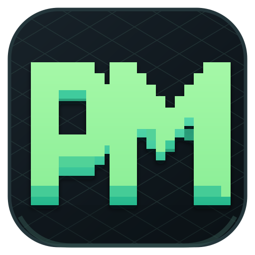

<p align="center">
  
</p>

<h1 align="center">PhysMap</h1>

<p align="center"><b>A free projection-mapping workspace for macOS, Windows, Linux, and the browser.</b></p>

<p align="center">Map light onto anything. Draw a shape over a real object, drag the corners to fit, and project &mdash; with images, video, text, a live camera, YouTube, sound-reactive animations and 2D physics, all in one focused window.</p>

<p align="center">
  <a href="https://github.com/mirauta-alexandru/PhysMap/releases"><b>Download for macOS / Windows / Linux &rarr;</b></a>
  |
  <a href="https://mirauta-alexandru.github.io/PhysMap/app.html"><b>Use in browser &rarr;</b></a>
</p>

---

## Why PhysMap

PhysMap is the easiest way to start with projection mapping. No expensive software,
no account, no cloud. It runs as a native desktop app or straight in the browser,
works offline, and is built around one idea: **lining projected light up with a real
object should be the whole workflow, not an afterthought.**

PhysMap opens a dedicated, fully black fullscreen window on your projector (a second
display), while the editor stays on your laptop. You keep modeling shapes on the
editor and the projector mirrors a clean output &mdash; no grid, no toolbar, no
handles &mdash; so you can align everything live on the wall.

### New in 0.3

- **Sound reactive** &mdash; a microphone, an audio file or a silent demo beat drives
  any surface; choose Bass, Mid or High per shape.
- **The browser version projects for real** &mdash; it opens its own output window,
  installs as an app and works offline.
- **Twelve new animations**, and every animation button now plays a live preview.
- **Text, camera and screen** as surface content, plus a **Circle** tool, rotate /
  scale, and arrow-key nudging.
- **Alignment that stays** &mdash; shapes scale with the stage, so a project keeps its
  place on the projector at any window size.

---

## What is projection mapping?

Projection mapping turns any real-world surface &mdash; a wall, a box, a building
facade, a sculpture &mdash; into a display. Instead of a flat rectangle, you shape the
projected light to match the physical object so graphics, video, or animation appear
to live *on* it.

---

## Download &amp; install

Grab the latest build from the [**Releases**](https://github.com/mirauta-alexandru/PhysMap/releases) page:

| Platform | File |
| --- | --- |
| **macOS** (Apple Silicon &amp; Intel) | `.dmg` |
| **Windows** (x64) | `.exe` installer |
| **Linux** (x64) | `.AppImage` or `.deb` |

### Or use it in the browser

Open **[mirauta-alexandru.github.io/PhysMap/app.html](https://mirauta-alexandru.github.io/PhysMap/app.html)**
&mdash; the same editor, nothing to install.

- Press **Output** and PhysMap opens a clean output window. In Chrome and Edge it can
  place that window directly on the projector (the browser asks once for permission
  to see your displays). In other browsers, drag the window onto the projector and
  click it once to go fullscreen.
- Use **Install App** on the Home screen (or the browser's install button) to keep
  PhysMap as an app that also works without a connection.
- Projects are stored in your browser, on your computer. Use **Export Project** to
  move one to another machine or to the desktop app.

The desktop app is still the most comfortable choice for shows, because it finds the
projector and goes fullscreen on it by itself.

> These are alpha builds. The macOS package is ad-hoc signed and the Windows one is
> unsigned, so on first launch you may need to **Control-click &rarr; Open** (macOS)
> or **More info &rarr; Run anyway** (Windows). Apple notarization and Windows code
> signing come later.
>
> Because ad-hoc macOS signatures change with every build, macOS cannot install
> these alpha updates through ShipIt. PhysMap detects that case and opens the
> correct Apple Silicon or Intel DMG for a manual reinstall. Once a Developer ID
> certificate is configured, the same update screen switches back to automatic
> in-app installation.

---

## Features

- **Dedicated projector output** &mdash; a separate, pure-black fullscreen window on
  the display you choose. The editor keeps running so you align live; unplug the
  projector and the output stops cleanly.
- **Live output safety** &mdash; freeze the last clean frame while you edit, or send
  an instant blackout without closing the projector window.
- **Scene Layers** &mdash; name, select, hide, lock and duplicate mapped surfaces,
  emitters, force fields, gates and portals from one organized scene view.
- **Quick-start templates** &mdash; begin with a blank stage, animated facade,
  physics lab, portal flow, sound stage or live sign instead of wiring every scene
  from zero.
- **Hands-on interactive tutorial** &mdash; create a dedicated practice project,
  draw and align a surface, apply motion, inspect display routing and press the
  real output control with step-by-step guidance.
- **Command palette** &mdash; press `Cmd/Ctrl + K` to search tools, scene actions,
  output controls and project commands.
- **Corner-pin mapping** &mdash; draw a square, triangle, circle or freeform line, then
  drag the points onto your object. 4-corner shapes get a true perspective warp.
  Rotate, scale and nudge from the inspector or with the arrow keys.
- **Sound reactive** &mdash; pick a microphone, an audio file or the built-in demo
  beat, then choose which band (Bass, Mid, High or everything) drives each surface
  and how strongly. Spectrum, Waveform and Beat Ring follow the sound on their own.
- **Workspace View** &mdash; choose grid density, snap points, add center / thirds /
  safe-area guides, or enter a distraction-free focus mode. Preferences persist.
- **Quick Looks** &mdash; apply a polished mapping style in one click, then tune its
  animation speed and projector brightness.
- **Universal quick actions** &mdash; right-click surfaces, lines, emitters, fields,
  gates, and portals to edit, duplicate, lock, hide, or delete them.
- **Put anything inside a shape:**
  - Solid / glow / pulse / rainbow fills
  - Animated LED outlines (static, snake, chase, sparks) with adjustable speed
  - 41 built-in animations with live previews: 3D cube / grid / orb, neon tunnel,
    starfield, helix, scan, equalizer, wave, radar, rings, kaleido, aurora,
    constellation, laser fan, topography, pixel rain, prism, fire, lightning, plasma,
    glitch, confetti, bokeh, galaxy, hex grid, a wall clock and more
  - **Text** &mdash; still, scrolling, blinking or typed out, in three typefaces, with
    live `{time}`, `{seconds}` and `{date}` values
  - An **imported image**, a **local video file** (loops, muted), or a **YouTube
    video** &mdash; all perspective-warped onto the shape
  - A **live camera** or a **shared screen / window**, mapped like any other media
- **Cut (mask)** &mdash; punch a black hole over part of the projection to hide light
  spill or carve content to an exact shape.
- **Curved lines** &mdash; with the Line tool, hover any segment and drag to bend it
  into a smooth curve, with a live preview. Close the path to form a shape.
- **Reactive physics** &mdash; emit configurable orb, cube or shard bursts with
  adjustable rate, power, count and spread. Add gravity, repulsion, vortices,
  portals, color gates and boost gates; gates can target one particle type.
- **Project hub** &mdash; animated startup, autosaved current project, and a library
  of named projects you can reopen any time.
- **Undo / Redo** with a deep history, and **Export / Import** scenes as `.json`.
- **Retro pixel-art interface** and **fully offline** &mdash; fonts and assets are
  bundled, no internet required.

---

## How to use it

1. **Pick your projector** &mdash; open **OUTPUT**, choose the display, and start the
   fullscreen output. The editor stays on your main screen.
2. **Draw a shape** over the real object &mdash; `Q` square, `T` triangle, `E` circle, `Y` line.
   (For a line, click point by point and double-click to finish; click back on the
   first point to close it into a shape.)
3. **Fit it** &mdash; switch to Select (`V`) and drag the corner points until the
   shape sits exactly on the object. With a line, drag any segment to curve it.
4. **Set its look** &mdash; in the inspector pick a fill (solid, glow, image, video,
   YouTube, animation, cut mask...) and a color.
5. **Align and play** &mdash; everything you do mirrors to the projector output in
   real time.
6. **Add sound** (optional) &mdash; open **Sound**, pick a source, then set
   **Motion &rarr; Sound reactive** on the surfaces that should move with the music.

---

## Keyboard shortcuts

| Key | Action |
| --- | --- |
| `V` | Select / move shapes, drag points |
| `Q` | Square / rectangle |
| `T` | Triangle |
| `E` | Circle / ellipse (hold `Shift` for a perfect circle) |
| `Y` | Line (drag a segment to curve it) |
| `Arrow keys` | Nudge the selected shape 1 px (`Shift`: 10 px) |
| `X` | Particle emitter |
| `1` / `2` / `3` | Place an orb / cube / shard |
| `G` / `H` / `J` | Gravity / repulsor / vortex |
| `K` / `L` / `O` | Color gate / boost gate / portal pair |
| `Delete` | Delete the selected object |
| `Cmd/Ctrl + D` | Duplicate the selected object |
| `Cmd/Ctrl + K` | Open the command palette |
| `S` | Toggle snap to grid |
| `Ctrl/Cmd + Z` | Undo |
| `Shift + Ctrl/Cmd + Z` | Redo |
| `Space` | Pause / resume physics |
| `C` | Clear particles |
| `R` | Reset scene |

---

## Build from source

You need [Node.js](https://nodejs.org) (v18+).

```bash
git clone https://github.com/mirauta-alexandru/PhysMap.git
cd PhysMap
npm install

npm run desktop      # run the desktop app locally (Electron)
npm run dev          # run the site locally; open /app.html for the editor
npm run build        # build the website + web app into dist/
```

Pushing to `main` runs the **Publish Website** workflow, which builds `dist/` and
deploys it to GitHub Pages (free for public repositories).

### Package native installers

```bash
npm run dist:mac     # macOS DMG (Apple Silicon + Intel)
npm run dist:win     # Windows x64 installer
npm run dist:linux   # Linux x64 AppImage + deb
```

Output is written to `release/`. Pushing a `vX.Y.Z` tag triggers the **Desktop
Release** GitHub Actions workflow, which builds all platforms and publishes a
GitHub Release with the installers attached.

---

## Tech

PhysMap is a small vanilla-JavaScript app wrapped in [Electron](https://www.electronjs.org/),
built with [Vite](https://vitejs.dev) and [Matter.js](https://brm.io/matter-js/) for
the 2D physics. The perspective warping runs on a plain 2D canvas (no WebGL, no heavy
dependencies), so it stays light and runs almost anywhere. Sound analysis uses the
Web Audio API; the web version is a static site with a small service worker for
offline use, so it needs no server and costs nothing to host.

---

## License

MIT &mdash; see [LICENSE](LICENSE). Free to use, modify, and share.
